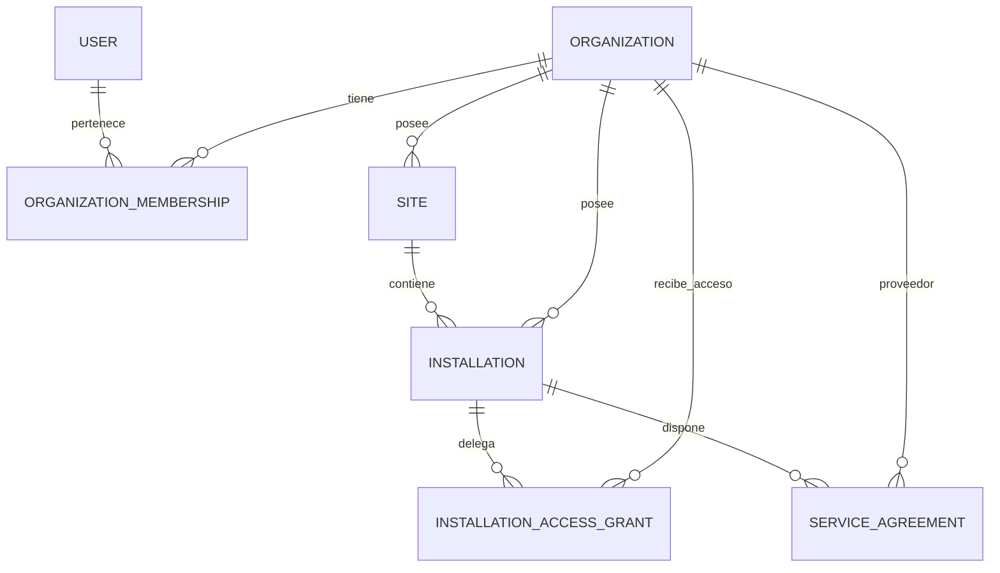
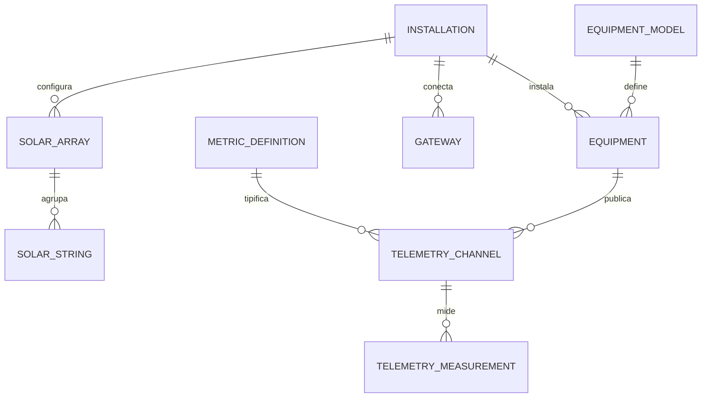
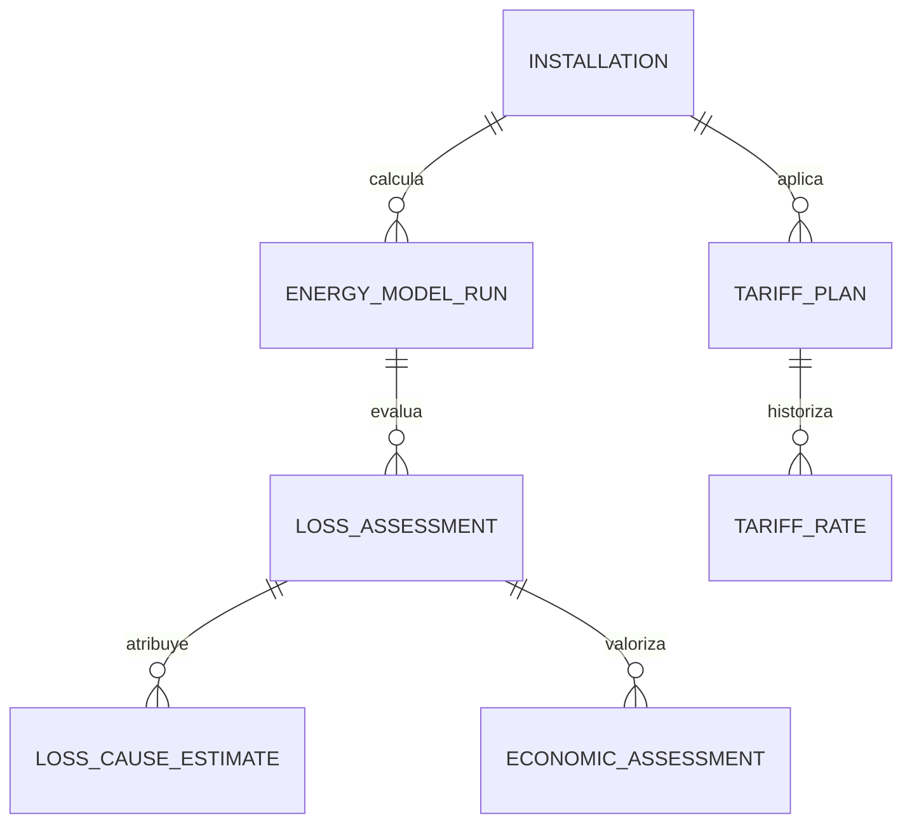
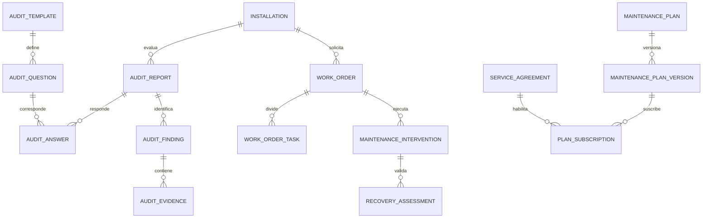

# SolarCare — Modelo entidad-relación v2, normalización y multi-tenant

**Estado:** Propuesta de diseño para Sprint 0.5. **No validado aún contra un JHipster generado ni contra un PostgreSQL real.**

## Dictamen sobre el diseño anterior

El JDL original (`specs/domain.initial.jdl`) define solo `Organization`, `Installation`, `Gateway` y `Audit`. No contiene `OrganizationMembership`, `Equipment`, `TelemetryChannel`, `Incident`, pérdidas, versiones de planes, relaciones de contratación, ni reglas de tenant. La lista textual de entidades que figuraba en el plan era un inventario conceptual, **no un ERD normalizado ni un esquema implementable**.

El archivo `specs/domain.v2.draft.jdl` amplía esa base a **37 entidades y 83 relaciones declaradas**, con enumeraciones y relaciones requeridas. Se debe validar la JDL contra el CLI exacto, revisar IDs, Liquibase, convenciones de nombres, y restringir los endpoints generados.

## 1. Decisión de tenencia

**Modelo recomendado:** pooled PostgreSQL; cada registro de negocio tiene `organization_id` y cada instalación pertenece a una organización. Las membresías `OrganizationMembership` unen un `jhi_user` existente con una empresa y un rol. El usuario puede tener varios memberships y seleccionar su organización activa. No confiar en `organizationId` enviado por Flutter/Angular; resolverlo de la identidad autenticada y verificar ACTIVE.

**Acceso delegado entre empresas:** `InstallationAccessGrant` autoriza a otra organización (por ejemplo, un mantenedor) a una instalación concreta; `ServiceAgreement` representa el acuerdo operacional entre propietario y proveedor; `WorkOrder` puede asignarse a un técnico del proveedor solo si existe alcance autorizado y vigente. El recurso **sigue perteneciendo al tenant del propietario**, no se copia entre empresas.

**Autorización:** usuario + membresía activa + operación + instalación + permiso/acuerdo. `ROLE_ADMIN` de JHipster es un rol de plataforma, **no equivalente a OWNER de cualquier empresa**. Nunca permitir filtros arbitrarios `?organizationId` para cambiar ámbito.

**Defensa por capas:** endpoints/services/queries con tenant-scope + RLS en PostgreSQL + FKs compuestas `(id, organization_id)` + pruebas negativas. No activar RLS sin diseñar la configuración transaccional en conexiones del pool; el rol SQL runtime debe ser diferente del owner y carecer de BYPASSRLS. RLS puede bloquear procesos batch si no manejan correctamente el contexto. Validar excepciones administrativas y acceso delegado por políticas dedicadas.

## 2. ER conceptual por dominios

### Identidad, ubicación, instalaciones y delegación

### Inventario eléctrico y captura

`TELEMETRY_MEASUREMENT` se crea mediante SQL/Liquibase, no con un CRUD JDL. `EquipmentModel` y `MetricDefinition` son catálogos globales de lectura; sus escrituras son exclusivas de plataforma. Modelar `SolarString` separado de paneles y arreglo permite comparaciones por string; cuando haya microinversores, modelar las relaciones físicas mediante identificadores/ubicación sin asumir que todos los módulos pertenecen a un único string eléctrico.

### Rendimiento y economía

`EnergyModelRun` conserva versión del modelo, rango UTC, energía esperada/real y cobertura. `LossAssessment` tiene el déficit total; `LossCauseEstimate` asigna partes compatibles sin superponer causas. `EconomicAssessment` utiliza tarifas con vigencia y conserva el importe estimado, moneda y supuestos de autoconsumo/inyección; no sustituye la facturación real.

### Auditoría, asistencia y suscripción

La preauditoría digital y la auditoría técnica validada no son equivalentes. El mismo expediente puede tener evidencias, pero nunca debe generar una certificación técnica automática. Las condiciones de una suscripción deben apuntar a una versión contractual inmutable.

## 3. Normalización: reglas concretas

1. **1FN:** no listas de strings/cables/equipos serializadas dentro de `Installation`. Tablas hijas por recurso real.
2. **2FN:** relaciones N:M con atributos propios mediante entidad puente (`OrganizationMembership`, `InstallationAccessGrant`, `ServiceAgreement`), no ManyToMany automática.
3. **3FN:** fabricantes/modelos en `EquipmentModel`; mediciones vinculadas a canal y definición de magnitud; localidad/sitio separado de instalación; tarifa y sus versiones separadas; plantilla de auditoría separada de respuestas.
4. **Desnormalización controlada:** `organization_id` se duplica en tablas dependientes por seguridad/RLS e índices. Exigir FKs compuestas y pruebas de consistencia: no es 3FN estricta en todas las tablas físicas.
5. **Derivados separados:** `EnergyModelRun`, `LossAssessment`, `EconomicAssessment` y rollups diarios son proyecciones historizadas, no fuente primaria de telemetría.
6. **Precios:** `BigDecimal` con moneda y vigencia; nunca `Double` para dinero. Potencia/irradiancia pueden almacenarse con precisión de sensor adecuada; preservar unidades y calidad.
7. **Tiempos:** `Instant` UTC para eventos; `LocalDate` para día comercial y zona IANA en `Site`; fechas sin zonas de un dispositivo deben recibir política explícita.
8. **No borrado físico por defecto:** eventos, auditorías firmadas, trabajos y contratos deben conservar historial, con reglas de retención y privacidad.

## 4. Restricciones que NO resuelve JDL

- Unicidad `UNIQUE(organization_id, code)` para instalaciones, equipos, nombres/códigos de strings y códigos de incidentes; `UNIQUE(organization_id, member_id)` para membresías.
- Integridad cruzada por `(installation_id, organization_id)` en incidentes, gateways, auditorías, etc.; relaciones con proveedor externo deben usar política/autorización distinta.
- RLS y permisos DB, no generados por JDL.
- Unicidad de `(gateway_id, event_id)` para idempotencia y outbox de telemetría.
- Particiones por tiempo, índices de consulta y retención de datos.
- Restricción de intervalos tarifarios solapados, posibles contratos vigentes y duplicación de suscripciones para un sitio.
- Estados y transiciones permitidas en auditorías, incidentes, trabajos, propuestas y suscripciones.
- Protección de evidencias en almacenamiento con claves de objeto tenant-safe y URLs temporales.
- Inmutabilidad de versión contractual y plantilla al emitir o firmar.
- Validación de permisos por instalación para técnicos externos; no basta con ser miembro de la empresa proveedora.

Ver ejemplos NO ejecutables sin adaptación a JHipster en `database/tenant-integrity.example.sql` y `database/telemetry.example.sql`.

## 5. Modelo de telemetría

**No crear `TelemetryMeasurement` mediante `jhipster entity`**. Usar DTO/evento de ingesta, validación JSON Schema y persistencia especial. Claves: `organization_id`, `installation_id`, `channel_id`, `gateway_id`, `event_id`, `measured_at`, `received_at`, `value_num`, `quality`, `source`.

Para no duplicar eventos, mantener `telemetry_ingest_dedup(gateway_id,event_id)` además de particiones por `measured_at`. La potencia instantánea no es energía acumulada. Registrar contadores, resets, unidades y coverage antes de monetizar pérdidas. El Edge utiliza SQLite/outbox y el cloud confirma la recepción idempotente.

## 6. Matriz de aislamiento — pruebas obligatorias

| Prueba | Resultado esperado |
|---|---|
| Usuario A lee instalación B por ID | 404 o 403 sin datos de B |
| Usuario A crea equipo con instalación B | Rechazo y ninguna fila creada |
| Técnico proveedor accede a instalación autorizada | Solo acciones vigentes del `AccessGrant` |
| Técnico proveedor intenta instalación vecina de B | Denegado |
| Usuario con membresía suspendida conserva JWT | Rechazo desde backend |
| Cambiar header/claim `organization_id` arbitrariamente | Sin cambio de alcance |
| Gateway A publica evento con `installation_id` B | Rechazo + registro de seguridad |
| Event ID duplicado después de corte de WAN | Una medición efectiva |
| RLS sin contexto en transacción | Cero filas |
| Restablecer conexión del pool con tenant diferente | No heredar contexto previo |
| Acceso a evidencia de otro tenant con URL manipulada | Rechazo |
| Auditoría/contrato antiguo después de cambiar plan | Permanece ligado a versión original |

## 7. SDD — cambios en sprints

**Sprint 0.5 — Dominio, ERD y persistencia (obligatorio antes de S1):**

- [ ] Auditar esquema y APIs del dashboard actual, incluyendo IDs, formatos, taxonomía de equipos y relaciones reales.
- [ ] Validar bounded contexts y cardinalidades 0..1, 1..N, N..M para cada entidad.
- [ ] Revisar normalización y dependencias funcionales, documentar excepciones físicas de tenant.
- [ ] Ejecutar `jhipster jdl specs/domain.v2.draft.jdl --json-only` sobre proyecto de prueba con versión fijada; corregir errores hasta que compile.
- [ ] Generar diagramas ER y migraciones Liquibase inspeccionadas, no importar a ciegas.
- [ ] Diseñar indexes, composite FKs, RLS y perfiles de acceso cross-tenant.
- [ ] Fixtures: dos empresas, dos instalaciones, usuario multiempresa, técnico externo y un gateway por organización.
- [ ] Test de seguridad que intente leer/escribir recursos ajenos y pruebe conexión DB reutilizada.

**S1:** tablas `Organization`, `OrganizationMembership`, `Site`, `Installation`, `InstallationAccessGrant`; base de permisos, perfiles y contextos multiempresa. **No más entidades** si no hay pruebas de aislamiento.

**S2:** `EquipmentModel`, `SolarArray`, `SolarString`, `Equipment`, `Gateway`, `MetricDefinition`, `TelemetryChannel` y migraciones SQL para mediciones + dedup.

**S3:** outbox, pairing, sincronización/idempotencia, ACL de gateway, RLS en ingesta.

**S4:** `EnergyModelRun`; contrato de versionado de modelo y entradas meteorológicas.

**S5:** `AlertRule`, `Incident`, `IncidentEvent`; dedup, permisos y estados.

**S6:** `LossAssessment`, `LossCauseEstimate`, `TariffPlan`, `TariffRate`, `EconomicAssessment`; validaciones y no doble conteo.

**S7:** `AuditTemplate`, `AuditQuestion`, `AuditReport`, `AuditAnswer`, `AuditFinding`, `AuditEvidence`; versionado e inspección offline.

**S8:** `MaintenancePlan`, `MaintenancePlanVersion`, `ServiceAgreement`, `PlanSubscription`, `ServiceProposal`, `WorkOrder`, `WorkOrderTask`, `MaintenanceIntervention`, `InterventionEvidence`, `RecoveryAssessment`.

**S9:** seguridad entre tenants, revisión de migraciones, rendimiento por volumen, retención, plan de restauración y QA E2E.

**S10:** piloto de varias instalaciones/empresas, calibrar modelo y evaluar coberturas operativas.

## 8. Decisiones a confirmar con equipo

- Una empresa puede ser a la vez propietaria, instaladora y prestadora. No asumir empresa=tipo inmutable; registrar roles por acuerdos de servicio.
- Revisar si el dashboard existente ya tiene equipo/instalación/canal y adaptarse; evitar duplicaciones en migración.
- Las instalaciones pueden incluir múltiples inversores, strings, baterías, medidores, microinversores y sensores. No imponer string a todos los equipos.
- Revisión de casos complejos: parques compartidos por varios propietarios, contratos de terceros y acceso de aseguradoras. Mantener capacidad de extensión sin incluirlos todos en MVP.
- No usar `Organization` como sustituto de `Customer` persona física sin definir titular/consentimiento. Un usuario residencial puede controlar una organización personal simple, pero los datos contractuales particulares requieren extensión posterior.
- Aclarar si `InstallationAccessGrant` permite acceso por organización completa o por membresía individual; preferir concesiones por membresía cuando haya técnico individual asignado.

## 9. Gate de salida de S0.5

No se aprueba el Sprint 1 hasta disponer de: JDL parseada por CLI exacto, migración aplicada a PostgreSQL limpio, ERD revisado con equipo, pruebas negativas multiempresa, recuperación de rollback/backup, fixtures de datos y API de listado tenant-safe.

## 10. Extensiones que NO conviene meter en el MVP

| Dominio | Entidades candidatas | Motivo para posponer |
|---|---|---|
| Drones | `Drone`, `DroneMission`, `FlightRiskCheck`, `DroneMedia` | La misión requiere operador autorizado, clima y reglas de seguridad; en el MVP solo simulación / orden de servicio |
| Satélite | `SatelliteScene`, `SatelliteProvider`, `SatelliteAnalysisResult` | Imágenes de satélite no certifican suciedad por panel; almacenar metadatos y referencias, no grandes imágenes en PostgreSQL |
| Meteorología | `WeatherObservation`, `WeatherAlert`, `ClimateProfile` | Observaciones de alta frecuencia se almacenan como series y configuraciones, no CRUD genéricos |
| Coberturas | `PolicyReference`, `Claim`, `CoverageExclusion` | Requiere integración con aseguradora habilitada; los planes actuales son servicios de mantenimiento |
| Garantías | `Warranty`, `WarrantyClaim`, `WarrantyDocument` | Valioso después de validar inventario y pasaporte de equipos |
| Notificaciones | `NotificationAttempt`, `NotificationPreference`, `DeliveryChannel` | Canales y reintentos deben diseñarse con permisos y preferencias |
| Propiedad compleja | `AssetOwner`, `OwnershipShare`, `TenantContact` | Necesario solo si el propietario legal difiere del tenant o hay copropiedad |

La decisión de aplazar no significa que sean irrelevantes: se registran como historias con contrato SDD. La **vista satelital** y el **envío de dron** del prototipo son simulaciones, no facultades operativas autorizadas.
