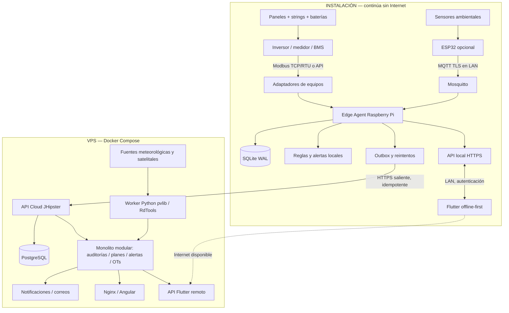

# SOLARCARE — Plan maestro de arquitectura y desarrollo guiado por especificaciones

**Versión:** 3.0 — actualización frontend-first  
**Fecha:** 22 de noviembre de 2026  
**Estado:** propuesta técnica, por validar con la telemetría y el dashboard existentes  
**Ámbito:** Jujuy, Salta; expansión multiempresa y multirregión  
**SDD:** Spec-Driven Development (desarrollo guiado por especificaciones)

> Este documento es un plan de implementación, NO una afirmación de que los proyectos hayan sido generados o que el hardware haya sido integrado.

## 1. Resumen ejecutivo y decisión

**Objetivo:** convertir un dashboard de telemetría solar existente en una plataforma que audite instalaciones, estime energía esperada en condiciones limpias y operativas, mida pérdidas reales y económicas, clasifique anomalías, cree alertas y órdenes técnicas, y venda **planes de monitoreo/mantenimiento** con alcance contractual. Seguros indemnizatorios, si se ofrecen, solamente mediante entidades y canales habilitados.

**Arquitectura:** monolito modular JHipster central + gateway local ligero en Raspberry Pi + adaptadores de inversor/ESP32 + motor Python de modelado + Angular web separado + Flutter móvil offline-first + Docker Compose para servidores y servicios.

**Principios no negociables:**

1. Reutilizar dashboard y fuentes existentes antes de generar código nuevo; inventariar protocolos, repositorios, datos y API.
2. El gateway continúa leyendo, registrando y evaluando reglas críticas locales sin internet ni VPS.
3. No atribuir toda caída de producción a suciedad. Mantener causas indeterminadas y calidad del dato.
4. Separar monitoreo de controles eléctricos. MVP **read-only**: ninguna escritura Modbus/maniobra remota.
5. Tener contrato de API y eventos versionados desde el Sprint 0; cambios con pruebas de compatibilidad.
6. Ser multiempresa desde la base de datos, sin microservicios de negocio prematuros.
7. Aplicaciones nativas Flutter y firmware ESP32 NO se despliegan con Docker. Docker orquesta API, web, gateway, broker, BD y workers.

## 2. Stack recomendado y decisiones de versión

| Capa | Selección propuesta | Motivo |
|---|---|---|
| Backend SaaS | JHipster 9.4.0, Java 21 LTS, Spring Boot 4, Maven | generación sólida, seguridad, Liquibase, testing |
| API | REST JSON/OpenAPI; SSE o WebSocket para live | contratos claros; móviles y web |
| Frontend | Angular standalone, TypeScript estricto, Tailwind CSS v4 | panel operativo separado; demo frontend-first sin backend |
| Móvil | Flutter 3.50.x, Dart, FVM, Riverpod, go_router, Drift/SQLite | offline-first y Android/iOS |
| Edge | Raspberry Pi 4/5 64-bit (o mini-PC) + servicio ligero Python | soporte local, almacenamiento, modelado sencillo |
| Firmware | ESP-IDF para ESP32, solo si falta adquisición | telemetría y sensores opcionales |
| Transporte industrial | Modbus TCP / RTU RS485 / API fabricante (solo lectura) | adaptación por modelo real |
| Broker local | Eclipse Mosquitto MQTT | desacoplar ingesta |
| BBDD SaaS | PostgreSQL + Liquibase; particionado si volumen exige | transaccional + series temporales |
| BBDD Edge | SQLite WAL, exportación/backup | tolerancia a desconexiones |
| Analítica | Python + pvlib; RdTools cuando datos alcancen | separación del cálculo físico |
| Entrega web | Nginx + TLS | proxy web y API |
| Contenedores | Docker Compose con contextos DEV/EDGE/CLOUD | despliegue sencillo; ARM64 verificado |
| Observabilidad | Actuator/Micrometer, logs JSON, métricas, alertas | operación |

**Verificación:** JHipster 9.4.0 publicado en septiembre de 2026; JHipster 9 requiere Java >=21 y 9.3+ genera Spring Boot 4. Angular 22 y Flutter 3.50 son líneas actuales a noviembre de 2026. Revisar compatibilidad exacta de Node/TypeScript al instalar y fijar los lockfiles.

## 3. Diagrama lógico



**Transporte esencial:** los dispositivos NO se exponen en internet. Solo conexiones salientes desde la Raspberry al VPS. Si existe un dashboard actual, integrarlo por adaptador o reutilizar su API y no sustituirlo sin auditoría.

## 4. Boundaries y responsabilidades

### 4.1 Raspberry Pi — Edge Agent

- Descubrimiento/registro de adaptadores por marca, modelo, firmware, protocolo y mapa de registros.
- Lectura de potencia AC/DC, tensión, corriente, energía, temperatura, alarmas y BMS si está disponible.
- Normalización a un contrato de telemetría común; timestamp UTC + quality flags.
- Buffer local SQLite, outbox, reintentos, desduplicación y control de reloj.
- API LAN para Flutter, heartbeat, historial acotado y estado del gateway.
- Reglas locales deterministas: conectividad, inversor offline, alarmas, batería fría, producción insuficiente **solo con irradiancia válida**.
- Emparejamiento QR/código temporal con credenciales locales propias (no reutilizar sesión cloud).
- Actualizaciones firmadas; observabilidad local; watchdog y UPS recomendado.

### 4.2 JHipster central — monolito modular

Paquetes/bounded contexts sugeridos:

- `identity_tenancy`: Organization, Membership, Role, AccessPolicy, SiteAccess.
- `assets`: Installation, Site, Array, PanelModel, String, Inverter, Battery, Meter, Sensor, Gateway, Equipment.
- `telemetry`: MeasurementIngestion, MeasurementQuality, DailyAggregate, GatewayHeartbeat.
- `performance`: ExpectedGeneration, LossEstimate, CauseHypothesis, MeasurementCoverage, MethodVersion.
- `climate`: WeatherSnapshot, SiteRiskProfile, ClimateEvent.
- `alerts`: AlertRule, Incident, AlertEvent, NotificationDispatch, Acknowledgment.
- `audits`: AuditTemplate, Audit, Finding, Evidence, CorrectiveAction, AuditSignoff.
- `maintenance`: WorkOrder, Assignment, Visit, Intervention, OutcomeVerification.
- `commercial`: MaintenancePlan, PlanBenefit, Proposal, Subscription, SLA, InvoiceReference.
- `reporting`: exports y resúmenes de energía, ahorro y recuperación.

No generar **Measurement** con CRUD JHipster convencional si se prevén millones de filas: crear ingestión por lotes, índices, políticas de retención y particiones o almacenamiento TS especializado cuando volumen lo justifique.

### 4.3 Angular

Rutas recomendadas: `overview`, `organizations`, `sites`, `assets`, `live`, `performance`, `incidents`, `audits`, `technicians`, `work-orders`, `plans`, `subscriptions`, `reports`, `settings`. Roles y contexto de empresa visibles. Tablas con filtros server-side, informes trazables y evidencias por auditoría.

### 4.4 Flutter

Dos experiencias según rol, dentro del mismo cliente móvil (se pueden separar en apps más adelante):

- **Propietario:** onboarding, emparejamiento QR, estado local/cloud, producción, pérdidas, tarifas, alertas, autorizar visita, documentos, historial.
- **Técnico:** agenda, checklist offline, evidencias fotográficas, hallazgos, firmas (si aplica), intervención, sincronización de cambios.

Arquitectura clean por features, repositorio dual local/remoto, cola durable de comandos, resolución de conflictos y base de datos local. mDNS/Bonjour con conexión manual de respaldo por IP; en iOS declarar permisos de red local. No prometer push confiable en teléfono bloqueado y sin internet.

### 4.5 Motor energético Python

- Calcular `E_expected_clean` con características de módulos/inversor, ubicación, inclinación, orientación, edad, meteorología y pérdidas habituales explícitas.
- Comparar energía observada con la referencia a intervalos equivalentes, excluyendo datos inválidos, cortes, clipping, curtailment y límites de exportación según disponibilidad.
- Clasificar el **déficit total** sin atribuir automáticamente causa.
- Analizar suciedad con historial y RdTools solamente si los datos alcanzan calidad/cobertura suficientes; añadir sensores limpio/sucio en fase avanzada.
- Versionar modelo, parámetros, fuente meteorológica e incertidumbre o banda si está calculada, jamás puntuaciones inventadas.

## 5. Seguridad y multiempresa

- Modelo tenant: `organization_id` obligatorio en registros de negocio; controles de acceso en aplicación + repositorio, jamás confiar solo en filtros frontend.
- Usuarios vinculados por `OrganizationMembership`; técnicos externos pueden requerir permisos temporales por instalación.
- Auth cloud para MVP: JWT de JHipster o OIDC si equipo ya dispone de IdP; elegir y documentar un único mecanismo. Para escala, preferir OIDC Authorization Code + PKCE en web/móvil.
- Auth local: pairing presencial QR + código efímero, credenciales por dispositivo, token local con expiración y revocación. Nunca copiar secretos cloud al ESP32.
- TLS para web/VPS y canal edge-cloud; secretos fuera de imágenes/repositorio, rotación y mínimos privilegios.
- API de ingestión autenticada para cada gateway, idempotencia por `(gatewayId, eventId)` y rechazo de instalaciones ajenas.
- OT: red segregada, lecturas solo en MVP, sin abrir Modbus a internet, ni control automático de inversor, batería o drones.
- Datos: backups cifrados, restauración probada, auditoría inmutable de cambios comerciales y críticos, políticas de retención y minimización de fotos/geolocalización.

## 6. Modelo de datos inicial

### Revisión del dominio v2 — bloqueante antes de Sprint 1

El `specs/domain.initial.jdl` solo tenía cuatro entidades y sirve como esquema introductorio. **No es el ERD completo, no está verificada su normalización y no implementa multitenencia por sí solo.** Se añade `specs/domain.v2.draft.jdl` con 37 entidades y 83 relaciones declaradas, y `docs/MODELO_ER_MULTITENANT_V2.md` con cardinalidades, normalización, RLS, relaciones entre empresas, telemetría de series temporales, pruebas y una fase S0.5 obligatoria. El JDL nuevo es un borrador: falta validarlo mediante JHipster CLI y migraciones Liquibase reales.


**Entidades transaccionales:** exactamente las **37 entidades declaradas** en `specs/domain.v2.draft.jdl`. Ver `docs/JDL_FRONTEND_ENTITY_MATRIX_V3.md` (lista exhaustiva, módulo, rutas y tratamiento UI). **No utilizar nombres históricos** como `SiteLocation`, `TariffSchedule` o `EnergyEstimate` como si fueran clases JDL existentes: el modelo actual utiliza `Site`, `TariffPlan`/`TariffRate` y `EnergyModelRun`.

**Uso:** JDL v2 es contrato provisional; hasta que S0.5 no valide importación y migraciones, el frontend usa modelos TS/mocks derivados de esta propuesta. No generar CRUD backend de manera automática durante la hackatón.

**Tablas de serie temporal (migraciones manuales):** `telemetry_measurement` (eventId, installationId, gatewayId, deviceId, ts UTC, powerW, energyWhCounter, irradianceWm2, moduleTemperatureC, status, qualityFlags, rawRef); `telemetry_daily` para agregación; `weather_observation`; `gateway_sync_checkpoint`.

**Reglas de granularidad:** potencias W; energías Wh internamente y kWh en UI; dinero con `BigDecimal` y moneda ISO; UTC en persistencia y zona horaria IANA por instalación. Una medición puntual de potencia NO se debe tratar como energía sin integrar por intervalos. Detectar reinicios del contador energético.

## 7. Contratos — API y eventos

**API REST v1 — recurso, método, propósito**

| Ruta | Métodos | Reglas |
|---|---|---|
| `/api/v1/installations` | GET/POST | Scope tenant, paginación |
| `/api/v1/installations/{id}/overview` | GET | Estado, datos medidos y estimados separados |
| `/api/v1/installations/{id}/performance` | GET | Desde/hasta, TZ, indicadores y cobertura |
| `/api/v1/alerts` | GET/POST | Listar, reglas, scope |
| `/api/v1/incidents/{id}/acknowledge` | POST | Auditoría de usuario |
| `/api/v1/audits` | GET/POST | Auditorías con versión de plantilla |
| `/api/v1/audits/{id}/findings` | POST | Evidencia y hallazgos |
| `/api/v1/maintenance/work-orders` | GET/POST | Workflow de OT |
| `/api/v1/plans` | GET | Catálogo de servicio, exclusiones |
| `/api/v1/proposals` | POST | Cotización versionada |
| `/api/v1/gateways/{id}/telemetry:batch` | POST | Auth gateway, deduplicación |
| `/api/v1/gateways/{id}/heartbeat` | POST | Estado de sync y salud |

**Eventos MQTT:**

- `solar/v1/{installationId}/{deviceId}/telemetry` — evento con `eventId`, UTC, medida, unidad y calidad.
- `solar/v1/{installationId}/{gatewayId}/status` — estado del dispositivo/gateway.
- Control y mensajes de administración separados, deshabilitados en MVP.

**Eventos de dominio:** `TELEMETRY_RECEIVED`, `INSUFFICIENT_IRRADIANCE`, `GENERATION_GAP_DETECTED`, `INVERTER_FAULT`, `POSSIBLE_SOILING`, `CLIMATE_RISK`, `INCIDENT_CREATED`, `AUDIT_SIGNED`, `WORK_ORDER_COMPLETED`, `RECOVERY_VERIFIED`.

**Compatibilidad:** OpenAPI y JSON Schema versionados; pruebas contractuales y fixture por fabricante. Breaking changes: nuevo endpoint/major/event schema y migrador.

## 8. Cálculos y monetización correcta

### 8.1 Energía de referencia

`E_clean(t) = modelo_fisico(irradiancia, temperatura, módulos, tilt, azimut, inversor, edad, restricciones)`  
`Déficit observado = max(0, Σ E_clean(t) - Σ E_real(t))` solo en intervalos elegibles y comparables.

**No** mostrar caída nocturna como falla; no interpretar un día nublado como panel sucio; no imputar como fallo módulos la energía limitada por el inversor o la red.

### 8.2 Atribución de causas

`LossEstimate` registra `lossTotalKWh`, `soilingAttributedKWh` solo si existe método válido, `unknownResidualKWh`, hipótesis (sin afirmar causalidad), calidad y método. Evitar doble conteo. Cambios bruscos sugieren investigación de fallas; cambios graduales pueden ser suciedad, degradación u otras causas.

### 8.3 Pérdida económica

Para cada intervalo `t`:

`valor_perdido_t = energia_autoconsumo_perdida_t × tarifa_compra_marginal_t + energía_que_habría_inyectado_t × tarifa_inyección_t`

La asignación anterior es conceptual y requiere medición de consumos y energía exportada. La asignación requiere curva de carga/importación/exportación, baterías y reglas tarifarias; si faltan datos, mostrar simulación y supuestos, nunca una factura real. Registrar vigencia temporal de tarifas. Cobro por cobertura **de mantenimiento**, no indemnización aseguradora sin socio autorizado.

### 8.4 Rentabilidad del mantenimiento

`beneficio_neto_estimado = valor_energía_recuperable_hasta_próxima_intervención - costo_total_intervención`.

Seguridad prioritaria: condiciones de cortocircuito, aislamiento, incendio, batería o cables dañados requieren revisión sin esperar ROI positivo.

## 9. Auditoría y cobertura — flujo de negocio

1. Alta de instalación por propietario o instalador (foto, ubicación, potencia, marca/modelo, número de serie, red/batería, facturas/garantía).
2. Preauditoría digital con evidencia y diagnóstico preliminar, **no certificado eléctrico**.
3. Auditoría presencial con checklist de paneles, estructuras, conectores, protecciones, puesta a tierra, baterías, mediciones y documentación; roles profesionales habilitados.
4. Clasificación: apta / apta con observaciones / requiere corrección / incompleta, cada hallazgo con riesgo, severidad, evidencia, fecha y responsable.
5. Presupuesto de adecuación si corresponde; revalidación después de corregir.
6. Propuesta de plan Esencial / Protección / Empresarial con alcance medible, exclusiones, visitas, desplazamientos, SLA y precios.
7. Suscripción, monitorización, alertas, órdenes de mantenimiento, verificación después de la intervención, renovaciones.
8. Producto asegurador — solo por tercero autorizado, contrato separado, revisión regulatoria previa.

## 10. SDD — flujo obligatorio para cada feature

**Fuente de verdad:** `specs/*.md`, `contracts/openapi.yaml`, `contracts/telemetry.schema.json`, `docs/ADR-*.md`, modelos JDL, fixtures y criterios de aceptación.

Ciclo por feature:

1. `SPEC`: actor, escenario, entrada, salida, restricciones, casos límite, protección de datos.
2. `DESIGN`: entidad/JDL o migración, diagrama de secuencia, contrato OpenAPI/evento, ADR si decisión irreversible.
3. `TASKS`: desglose API, edge, web, móvil, tests y migración; cada tarea vinculada a FR-ID.
4. `IMPLEMENT`: usar CLI oficial y convenciones; sin duplicar modelos ni romper código existente.
5. `VERIFY`: unit/integration/contract/E2E, sin internet, datos faltantes, seguridad tenant, restauración y performance.
6. `REVIEW`: demo con evidencia y métricas, actualizar documentación y fijar contrato.

No aprobar sprints solo por screenshots; deben existir pruebas repetibles. Cada feature incluye trazabilidad `FR-XXX → API/schema → test → commit/PR`.

## 11. Plan de sprints

**Cadencia de referencia:** Sprint 0 de preparación + 10 sprints de 1–2 semanas; estimaciones dependen de equipo, experiencia, acceso al inversor y disponibilidad de datos. Iteraciones verticales; cada sprint agrega flujo observable, no solo capas técnicas.

| Sprint | Objetivo funcional | Backend / Edge | Angular | Flutter | Definition of Done principal |
|---|---|---|---|---|---|
| 0 | Descubrimiento y SDD | Auditoría sistema actual, protocolo, specs, ADR, OpenAPI, fixtures | inventario dashboard | flujo principal / maqueta | alcance MVP, 1 fixture real anonimizado o simulador identificado |
| 0.5 | Modelo ER y multi-tenant | JDL v2, revisión 3FN, FKs compuestas, política RLS, fixtures de dos empresas | diagrama de datos y permisos | flujos de usuarios multiempresa | parseo JDL, migración PostgreSQL y pruebas tenant negativas |
| 1 | Base multiempresa | JHipster backend-only, PostgreSQL, roles/tenant, Docker dev, API health | shell y login | shell, flujos y estado local | login y tenant isolation test |
| 2 | Primera telemetría real | Adaptador read-only inversor o simulador, MQTT, SQLite edge | vista live | vista live LAN | mediciones con tiempo/unidades + desconexión |
| 3 | Local-first y sincronización | outbox durable, API edge, batch cloud idempotente | estado de gateway | pairing QR, caché | desconectar WAN y no perder registros |
| 4 | Modelo de energía | inventario técnico + worker pvlib + meteo | comparativa esperada/real | rendimiento diario | cálculo con fixtures y flags de calidad |
| 5 | Alertas + clima | reglas, dedup, incidentes, riesgos regionales | bandeja y detalle | avisos en app, reconocimiento | prueba offline, caída inversor, escarcha no confirmada |
| 6 | Pérdidas y dinero | curvas de carga/tarifas, separación desconocidos, costo | simulador e históricos | costo y energía | no atribuir a suciedad sin evidencia ni doble conteo |
| 7 | Auditoría técnica | templates, hallazgos, evidencia, revisión y firma | auditoría y expediente | checklist y fotos offline | auditoría completa trazable y tenant-safe |
| 8 | Mantenimiento y planes | OT, asignaciones, propuesta, plan/SLA, intervención | tablero técnico/comercial | visita y aprobación | solicitud→técnico→reparación→verificación |
| 9 | Resiliencia y seguridad | backup/restore, hardening, load/chaos, observabilidad | E2E y accesibilidad | pruebas Android/iOS offline | gates de QA, no exposición de OT, recuperación probada |
| 10 | Piloto controlado | calibración, métricas, reportes, rollout | feedback operadores | UX y soporte | piloto real, métricas y plan de operación |

### Sprint 0 — entregables imprescindibles

- Inventario del dashboard actual, repositorio, endpoints, tecnologías, autenticación, licencia y calidad de datos.
- Al menos un modelo de inversor + especificación del protocolo real; o simulador marcado como tal.
- Diagramas L1/L2, ADR-001/002/003; especificaciones FR/NFR; contrato de telemetría y OpenAPI.
- Matriz de responsabilidades/roles y criterio de seguridad eléctrica (solo lectura).
- Decisión documentada: leer directamente inversor o usar ESP32 para sensores faltantes.

### Sprint 1 — entregables imprescindibles

- Proyecto JHipster backend-only generado por CLI, PostgreSQL/Liquibase, Compose infra.
- Modelo Organization/Membership/Installation/Gateway y un endpoint `overview` con fixtures.
- Angular y Flutter creados por CLI oficial, capas compartidas por contratos (generación de cliente opcional).
- Tests automatizados de aislamiento `organization_id`.

### Sprint 2 — entregables imprescindibles

- Adapter interface `read_status`, `read_measurements`, `capabilities`; implementador de inversor real o simulador.
- MQTT event validado contra JSON Schema, readings persistidos SQLite, timestamps UTC.
- Vista web y móvil mostrando LIVE, STALE, OFFLINE; no usar valores cache como en vivo.

### Sprint 3 — entregables imprescindibles

- Outbox edge persistente, retry exponencial, orden tolerante, deduplicación `(gatewayId,eventId)`.
- Pairing seguro por QR/código temporal y descubrimiento LAN con respaldo de dirección manual.
- Test: desconectar WAN, producir eventos, reconectar; sincronizar una sola vez.

### Sprint 4 — entregables imprescindibles

- Wizard de características de sitio y equipos; meteorología versionada con fuente y frescura.
- Motor `E_expected_clean`, comparación con períodos equivalentes, cobertura mínima y banderas.
- Visualizaciones sin afirmar causa; test vs fixtures conocidos.

### Sprint 5 — entregables imprescindibles

- Reglas deterministas: pérdida de comunicación, error de inversor, batería restringida, baja generación ante irradiancia válida.
- Alertas con `OPEN/ACKNOWLEDGED/IN_PROGRESS/RESOLVED/SUPPRESSED`, deduplicación por instalación/causa/ventana.
- Riesgos parametrizables: Puna (frío/viento), Quebrada (polvo/sombra), Valles (granizo/tormentas), Yungas (humedad), Chaco (calor).

### Sprint 6 — entregables imprescindibles

- Cargar tarifa variable de compra/venta con vigencia; curva de consumo y energía inyectada cuando exista.
- Mostrar medido vs modelado, desconocido, evitado por autoconsumo vs inyección; sin facturación inventada.
- Métricas de impacto con pruebas de no doble conteo y proyección condicionada.

### Sprint 7 — entregables imprescindibles

- Plantilla versionada de auditoría, formulario técnico offline, evidencias y hallazgos.
- Informe inicial (no certificado) + posterior informe firmado por profesional si aplica.
- Condición `requiere corrección` bloquea activación de prestaciones incompatibles.

### Sprint 8 — entregables imprescindibles

- Planes versionados Esencial/Protección/Empresa, SLA por zona y exclusiones.
- Flujo aprobación de visita, asignación de técnico, checklist, evidencia, cierre y medición postintervención.
- Trazabilidad comercial; distinguir plan de servicios vs póliza.

### Sprint 9 — entregables imprescindibles

- Recuperación ante caída de Raspberry, VPS, router, broker y equipos; UPS y backup documentados.
- Pentest de autorización multiempresa, TLS, secretos, logs sin tokens, límites y retención.
- Android/iOS real o emulador con permisos LAN y sincronización de formularios; monitoreo.

### Sprint 10 — entregables imprescindibles

- Piloto mínimo con 2–3 clases de instalación distintas y técnicos; registrar incidentes, falsos positivos y cobertura de medición.
- Informe de viabilidad del SaaS: costo por instalación, tasa de alertas accionables, horas offline, mantenimiento requerido, beneficios verificados.
- Backlog calibrado y requisitos de operación para producción.

## 12. Hackatón — recorte de 48–72 horas (sin prometer producción)

**Meta demo:** panel existente → mensaje telemétrico → estado local → modelo esperado → caída detectada → estimación kWh/$ → alerta → solicitud de técnico.

1. Integración con API existente o un simulador identificable; una sola instalación y un modelo de inversor.
2. JHipster backend-only + PostgreSQL (o backend existente auditado), Angular vista del caso y Flutter consulta local.
3. Motor de cálculo simplificado con irradiancia conocida y parámetros transparentes; NO atribuir suciedad de forma cierta.
4. Cambiar entre NORMAL, FALLA_INVERSOR y POSIBLE_SUCIEDAD para demostrar el flujo, con datos ficticios rotulados.
5. Auditoría checklist mínimo + oferta de un plan comercial prototipo, sin activar servicios no contratados.

**No construir para la hackatón:** pagos reales, seguro regulado, control remoto de hardware, robots/drones, multi fabricante completo, modelos ML complejos.

## 13. CLI oficial — scaffolding reproducible

**Prerequisitos:** macOS/Linux, Java 21, Maven, Node 24 compatible, npm, Docker Compose v2, Python 3.12+, Flutter/FVM, Android SDK y Xcode en macOS para iOS. Confirmar versiones en las herramientas correspondientes.

### 13.1 Estructura de trabajo

```bash
mkdir -p solarcare/{apps,services,firmware,infra,docs,specs,contracts}
cd solarcare
```

### 13.2 JHipster backend only (CLI)

```bash
npm install -g generator-jhipster@9.4.0
java -version && node --version && jhipster --version
mkdir -p apps/solarcare-api
cd apps/solarcare-api
jhipster --skip-client
# Opciones sugeridas en asistente: monolith; PostgreSQL; JWT para MVP (o OIDC si IdP existente); Maven; Java 21.
# Guardar configuración generada; validar salida y crear modelos JDL antes de importarlos.
# Desde apps/solarcare-api una vez creada una JDL válida:
# jhipster jdl ../../specs/domain.v2.draft.jdl --json-only # SOLO en entorno de prueba y tras revisión; NO producción
./mvnw test
cd ../..
```

No forzar un generador para tablas de alto volumen; crear migraciones explícitas de series temporales.

### 13.3 Angular separado (CLI)

```bash
npx @angular/cli@latest new solarcare-web --directory=apps/solarcare-web \
  --routing --style=css --standalone --strict --skip-git
cd apps/solarcare-web
npx ng add tailwindcss
npx ng generate component features/installations/pages/installation-list --standalone
npx ng generate service core/demo/demo-store
npm run build
npm test -- --watch=false
cd ../..
```

Tailwind es la base visual del demo. Angular Material es opcional y solo para controles específicos si se justifican (sin importar su estética global). En frontend-first no llamar a OpenAPI ni backend: usar puertos con adapters mock, e incorporar el cliente OpenAPI al integrar JHipster.

### 13.4 Flutter usando FVM (CLI)

```bash
mkdir -p apps/solarcare-mobile
cd apps/solarcare-mobile
fvm install 3.50.1
fvm use 3.50.1
fvm flutter create --project-name solarcare_mobile --org ar.solarcare \
  --platforms=android,ios .
fvm flutter pub add flutter_riverpod go_router dio drift sqlite3_flutter_libs path_provider
fvm flutter pub add --dev build_runner drift_dev
fvm flutter analyze
fvm flutter test
# Con emulador/device conectado:
# fvm flutter devices
# fvm flutter run
cd ../..
```

Revisar versiones de paquetes y compatibilidad reales, no actualizar automáticamente una vez fijados lockfiles.

### 13.5 ESP-IDF (solo si es necesario)

```bash
# ESP-IDF instalado y exportado en PATH:
mkdir -p firmware
cd firmware
idf.py create-project solarcare-sensor
cd solarcare-sensor
idf.py set-target esp32
idf.py build
# Con placa y puerto confirmados, y con credenciales provisionadas de forma segura:
# idf.py -p /dev/ttyUSB0 flash monitor
cd ../../
```

### 13.6 Docker Compose

```bash
# Infra de desarrollo: después de configurar .env y mqtt/config.
docker compose -f infra/compose.infra.yaml config
docker compose -f infra/compose.infra.yaml up -d
docker compose -f infra/compose.infra.yaml ps
```

**IMPORTANTE:** para ejecutar contenedores de las apps, primero generar imágenes Docker de JHipster/Angular/Edge/Worker y completar sus Compose cloud/edge; el Compose incluido en el paquete levanta solamente infraestructura de desarrollo. No afirmar que Flutter/iOS/ESP32 corren en Docker. Para Raspberry Pi usar imágenes ARM64, y perfiles DEV/EDGE/CLOUD según host.

## 14. Docker y topología

**DEV (notebook):** postgres, mosquitto, mailpit y servicios de la app cuando existan, con volúmenes y healthchecks. Angular puede correr con `ng serve` y proxy de desarrollo.

**EDGE (Raspberry Pi):** `solarcare-edge-agent`, `mosquitto`, SQLite persistente en volumen respaldado; proxy LAN si HTTPS; sistema operativo 64-bit; arranque automático y restart policies; watchdog/UPS. Evitar servicios pesados innecesarios en Pi.

**CLOUD (VPS):** Nginx TLS, API JHipster, PostgreSQL, worker Python, scheduler y backup/observabilidad; segmentación de redes y secrets. No publicar PostgreSQL ni broker MQTT en internet.

Imágenes multi-arquitectura si se comparten entre cloud AMD64 y edge ARM64; comprobar `docker buildx imagetools inspect` de cada imagen. Para Raspberry preferir imágenes `linux/arm64` sin emulación.

## 15. QA y escenarios adversos

| Caso | Resultado verificable |
|---|---|
| Noche, potencia 0 | no falsa alerta de pérdida |
| Nublado, producción baja coherente | no alerta suciedad |
| Inversor reporta error | incidente con código y evidencia |
| No llegan datos MQTT | comunicación OFFLINE, no afirmar falla de panel |
| Cortar internet 24 h (simulación) | eventos siguen locales y luego sincronizan una sola vez |
| Duplicar lote o enviar desordenado | API idempotente y ordenación por timestamp |
| Batería fría con BMS | restricción de carga, sin culpar a panel |
| Granizo + caída persistente | sugerir inspección, no concluir daño sin prueba |
| Usuario A accede a instalación de B | HTTP 403/404 según política |
| Tarifa cambia durante período | costo calculado con vigencia correcta |
| Se limpia panel y mejora sol | atribución requiere normalización meteorológica |
| Cambia fecha/hora gateway | marca `CLOCK_SKEW` y limita estimación |
| Un técnico edita hallazgo offline | merge seguro, conflictos visibles, auditoría |
| Restaurar base y volúmenes | RPO/RTO objetivo probado y documentado |

## 16. Indicadores de aceptación y operación

**Producto:** cobertura de instalaciones activas, % telemetría válida, incidentes accionables, tiempos de detección/ack/reparación, recuperación de energía verificable, retención de planes.

**Edge:** uptime, lag de adquisición, tamaño outbox, tiempo sin sincronizar, errores por fabricante, uso CPU/memoria/SSD.

**Modelo energético:** error normalizado por tipo de instalación, cobertura de períodos, precisión de eventos confirmados en inspección, separación `unknown`. No usar un score de confianza arbitrario.

**SLA propuesta (no garantías implícitas):** parámetros por plan/área, horas hábiles, exclusiones climáticas y tiempos de atención desde aceptación. Definir después del piloto real.

## 17. Riesgos y mitigación

1. **Telemetría inadecuada:** piloto primero con protocolo real; si solamente existe energía total, diagnóstico por panel imposible.
2. **Satélite ≠ cámara de suciedad:** usar satélite para irradiancia/contexto; no inferir capa de polvo individual sin evidencia.
3. **Falsas alertas:** histéresis, ventanas y calidad del dato; registrar causa desconocida.
4. **Sobrecarga de hardware:** Pi solo hace edge; procesamiento pesado en cloud/worker, no ejecutar JHipster entero si no es imprescindible.
5. **Seguridad eléctrica y clima extremo:** protecciones certificadas independientes del software, modelos de equipos y límites reales.
6. **Regulatorio:** plan de servicio != seguro; revisión jurídica/SSN cuando aplique.
7. **Logística:** técnicos, distancia, combustible, accesibilidad y excepciones por fenómenos climáticos en costos/SLA.
8. **Escala:** particionado y agregaciones sólo cuando volumen lo exija; observabilidad y pruebas de carga antes de optimizar.
9. **Integración existente:** adaptar/rehusar dashboard actual, no reemplazar funcionalidad sin prueba de paridad.

## 18. Definition of Done transversal

Una historia se considera terminada si:

- Existe SPEC versionada y criterio Given/When/Then; no desarrollo especulativo.
- API/contrato/evento actualizado y prueba de compatibilidad.
- Maneja estados offline, nulos, duplicados, errores y permisos.
- Incluye test del nivel correspondiente (unit/integration/contract/E2E).
- Se verificó en Angular y Flutter cuando el flujo aplica.
- Migración Liquibase y rollback/estrategia de datos documentados.
- Logging estructurado sin secretos/PII innecesaria.
- Documentación de despliegue y demo honesta con datos reales o simulados rotulados.

## 19. Fuentes técnicas verificadas

- JHipster 9.4 release: https://www.jhipster.tech/2026/09/17/jhipster-release-9.4.0.html
- JHipster JDL: https://www.jhipster.tech/jdl/intro/
- Angular CLI: https://angular.dev/cli/new
- Angular compatibilidad: https://angular.dev/reference/versions
- Flutter CLI: https://docs.flutter.dev/reference/create-new-app
- FVM: https://fvm.app/documentation/getting-started/overview
- ESP-IDF: https://docs.espressif.com/projects/esp-idf/en/stable/esp32/api-guides/tools/idf-py.html
- Docker Compose: https://docs.docker.com/compose/how-tos/profiles/
- Docker multiarch: https://docs.docker.com/build/building/multi-platform/
- pvlib: https://pvlib-python.readthedocs.io/en/stable/reference/modelchain.html
- RdTools soiling: https://rdtools.readthedocs.io/en/stable/generated/rdtools.soiling.html
- SunSpec Modbus: https://sunspec.org/modbus/
- Apple red local: https://developer.apple.com/documentation/BundleResources/Information-Property-List/NSLocalNetworkUsageDescription

## 20. Primera reunión de ejecución

Antes de generar código: acceder al dashboard actual, inventariar repositorio/BD/API, obtener marca y modelo del inversor, muestra anonimizada de telemetría, permisos de acceso, sensores instalados, tipo de instalación (red/híbrida/aislada) y alcance comercial de planes. Si no hay equipo real, acordar un simulador explícito con los mismos contratos. **No usar datos fingidos como evidencia de eficacia.**


## Actualización frontend-first v3 — hackatón

- El frontend Angular no necesita backend durante la hackatón: usar adapters mock + fixtures persistentes.
- Referencia normativa de pantallas: `solarcare-sdd/docs/JDL_FRONTEND_ENTITY_MATRIX_V3.md` para las 37 entidades del JDL v2.
- Plan F0–F7: `solarcare-sdd/docs/FRONTEND_FIRST_SPRINTS_V3.md`.
- Dirección de arte Quebrada: `solarcare-sdd/docs/DESIGN_SYSTEM_QUEBRADA_V3.md`.
- Prompt ejecutable para cualquier IA: `solarcare-sdd/prompts/PROMPT_MAESTRO_ANGULAR_FRONTEND_MOCK_V3.md`.
- La integración JHipster, RLS y Liquibase sigue bloqueada por S0.5 de validación real; el demo no equivale a backend validado.
