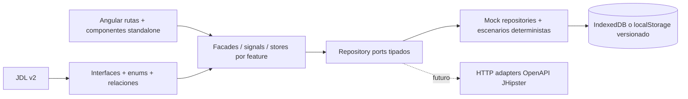

# SolarCare — Plan SDD frontend-first para hackatón (sin backend)

**Estado:** plan ejecutable para un agente, no implementación Angular terminada.
**JDL de origen:** `specs/domain.v2.draft.jdl`. Fuente de verdad de nombres, tipos, relaciones y enums. 37 entidades, 83 relaciones. **JDL pendiente de validación real con JHipster CLI.**

## Objetivo y alcance

Construir en `apps/solarcare-web` una aplicación Angular standalone + Tailwind, navegable y con comportamiento funcional íntegramente local. **No depender de ningún backend, ni de internet en runtime.** Debe demostrar valor del producto en la hackatón a partir de escenarios simulados reproducibles, diferenciando todos los datos simulados de mediciones reales.

## Arquitectura del demo

- Usar `InjectionToken`/providers para conmutar repositorios mock ↔ HTTP sin reescribir pantallas.
- Usar Angular Router y lazy loading. Signals/computed para estado observable. Formularios con validación de campos reales, eventos y estados por feature.
- Datos de demo reproducibles con `seedVersion` y `resetDemo`, no `Math.random()` sin semilla ni timers que alteren la integridad.
- Persistencia local versionada por tenant (en demo) y exportación/importación JSON validada.
- Un único `DemoClock` para reproducir 24 horas en el parque y simular latencia, fallas, conexión de Raspberry y reconexión del VPS.
- Los endpoints no se ejecutan ahora: un adaptador HTTP futuro implementará los mismos contratos.

## Entregas por sprint del frontend (paralelas al plan backend S0–S10)

| Sprint demo | Objetivo | Alcance funcional / JDL | Criterio de aceptación |
|---|---|---|---|
| F0 | Inventario + dirección artística | Parseo JDL, 37 entidades, navegación, design tokens Quebrada | Documento de cobertura y 3 vistas de referencia, tokens auditados; sin código inútil |
| F1 | Shell y tenant demo | Organization, OrganizationMembership, Site, Installation, AccessGrant | Selección de organización, 4 roles, rutas y fixtures multiempresa sin mezclas |
| F2 | Operación solar y gemelo digital | EquipmentModel, SolarArray, SolarString, Equipment, Gateway, MetricDefinition, TelemetryChannel | Planta cenital clicable, paneles por bloque, gateway, escenarios y datos sin backend |
| F3 | Rendimiento y alertas | AlertRule, Incident, IncidentEvent, EnergyModelRun, LossAssessment, LossCauseEstimate | Desencadenar escenario, seguir alerta, deduplicar y medir diferencial energético |
| F4 | Economía | TariffPlan, TariffRate, EconomicAssessment | Configurar tarifa, autoconsumo/exportación, pérdidas ARS, variaciones y validación de unidades |
| F5 | Auditoría | AuditTemplate, AuditQuestion, AuditReport, AuditAnswer, AuditFinding, AuditEvidence | Checklist 100% navegable, crear hallazgo/foto local, guardar/reabrir y cerrar revisión |
| F6 | Planes y operación de campo | MaintenancePlan, MaintenancePlanVersion, ServiceAgreement, PlanSubscription, ServiceProposal, WorkOrder, WorkOrderTask, MaintenanceIntervention, InterventionEvidence, RecoveryAssessment | Plan→orden→dron/técnico/propietario→intervención→comparación antes/después con bloqueos seguros |
| F7 | Calidad y puesta en escena | A11y, responsivo, performance, e2e | Build + tests + capturas desktop/tablet/mobile + guion demo de 5 minutos |

## Escenarios precargados y estados

1. Casa conectada a red en San Salvador de Jujuy: alertas y limpieza accesible desde suelo solo si procede.
2. Hogar híbrido de Abra Pampa: noche helada, BMS restringe carga, escarcha y recuperación matinal.
3. Parque fotovoltaico de la Puna: contaminación por polvo en sectores, detección, despacho de dron validado.
4. Parque con falla de inversor: despachar técnico, NO dron para limpieza.
5. Nube pasajera: caída meteorológica, NO incidente de suciedad ni orden de trabajo.
6. Granizo: evento de alto riesgo, inspección técnica y registro fotográfico; no prometer reparación automática.
7. Mantenimiento con pérdida de WAN: Raspberry y app LAN continúan en la simulación; eventos pendientes sincronizan sin duplicarse.
8. Usuario técnico del proveedor externo: solo instalación delegada y permisos vigentes.

## Restricciones importantes

- Nunca simular un dron autónomo real como acción enviada a hardware. Es un circuito de UX, no autorización operativa.
- El propietario NO recibe instrucciones de subir a un techo ni lavar paneles con helada.
- No mostrar porcentaje de confianza inventado; usar `diagnóstico preliminar`, `validado en el escenario` o `datos insuficientes`.
- Pérdidas: `E_esperada_limpia - E_real` después de comparar intervalos equivalentes; no confundir kW de potencia con kWh de energía.
- Costos: distinguir autoconsumo e inyección con tarifas configurables; ARS simulados no tarifas vigentes.
- No fingir que el frontend evita accesos multi-tenant: es simulación de roles; seguridad final es backend/RLS.

## Definition of Done global

- 100% rutas navegables, sin botones inertes.
- Cada formulario que se muestre debe crear/editar y persistir realmente en el mock, o informar claramente que es de solo lectura.
- 37 entidades mapeadas en modelo TypeScript/relaciones, y cada entidad accesible en flujo principal o editor contextual.
- Sin solicitudes HTTP ni dependencias de servidores al navegar por el demo.
- Se prueban estados vacíos, fallidos, carga, éxito y falta de datos.
- Cero errores de TypeScript en `ng build`, unit tests y smoke E2E pasando.
- Sin scroll horizontal a 375px; pruebas a 375, 768, 1280 y 1440 px.
- Contraste AA verificado (texto normal ≥4.5:1) y `prefers-reduced-motion` respetado.
- Informe de evidencias: URL local, capturas, comandos ejecutados, pruebas, limitaciones reales.
