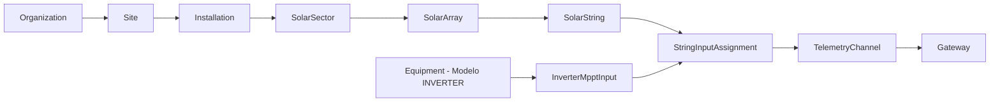
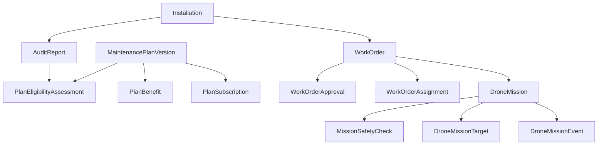

# HelioGuard — Análisis del JDL v5 y normalización del dominio

**Base exacta:** `specs/domain.v4.original.jdl` + `specs/REQUIREMENTS.md` aportados por el usuario. **Documento de salida:** `specs/domain.v5.review.jdl`. **Estado:** borrador auditado estructuralmente; pendiente de parser JHipster, Liquibase real, diseño de permisos y pruebas sobre PostgreSQL.

## Diagnóstico

La v4 tenía 47 entidades, un único bloque de relaciones y buena cobertura nominal del dominio, pero no expresaba toda la topología física, el historial de asignaciones, la evaluación de elegibilidad, las reglas de alerta versionadas ni un estado explícito para cálculo energético insuficiente. El JDL v5 mantiene **47 entidades previas**, añade **20 entidades nuevas**, actualiza campos y relaciones: **67 entidades, 178 relaciones ManyToOne y 44 enums**.

No es metodológicamente correcto certificar 3FN a partir de un JDL: faltan restricciones físicas, claves candidatas, dependencias funcionales demostradas y pruebas de migración. Se ha aplicado **normalización lógica orientada a 3FN**, con excepciones físicas deliberadas y documentadas.

## 1. Conjuntos del modelo

| Módulo | Entidades nuevas | Motivo |
|---|---|---|
| Topología | `SolarSector`, `InverterMpptInput`, `StringInputAssignment`, `EquipmentConnection` | Localizar por sector, inversor/MPPT/string y mantener topología histórica |
| Edge | `TelemetryChannelBinding` | Asociación temporal canal ↔ gateway, sin suponer un solo lector para siempre |
| Clima y modelo | `ClimateRiskProfile`, `WeatherIngestionBatch`, `EnergyModelConfiguration` | Reglas regionales, trazabilidad meteorológica, configuración física inmutable |
| Alertas | `IncidentLocalization`, `AlertRuleVersion` | Localización con evidencia y reglas versionadas |
| Auditoría | `AuditReportSignature` | Registro de aceptación/firma del expediente, sin prometer firma digital legal |
| Operación | `WorkOrderAssignment`, `WorkOrderApproval` | Historial de técnico, proveedor y consentimiento del dueño |
| Planes | `PlanBenefit`, `PlanEligibilityAssessment` | Beneficios y elegibilidad sin confundir servicio con seguro |
| Seguridad | `SecurityCaseEvent`, `SecurityCaseEvidence` | Bitácora/evidencia de investigación de inconsistencias |
| Drones | `DroneMissionTarget`, `DroneMissionEvent`, `MissionSafetyCheck` | Objetivos, trazabilidad y gate de seguridad |

## 2. Cambios a entidades existentes (y justificación)

- `Equipment.kind` **retirado**. El tipo se determina por `Equipment.equipmentModel.kind`, evitando dependencia transitiva y dos posibles fuentes discordantes. Si existiese una base desplegada, migrar verificando que valores no contradigan el catálogo antes de eliminar columna.
- `AlertRule.thresholdValue` y `AlertRule.minPersistenceSeconds` **retirados**. La configuración mutable/versionada está exclusivamente en `AlertRuleVersion` (comparador, ventana, umbral, cooldown, cobertura). No reescribir reglas históricas.
- `Incident.alertRule` **retirado** para no duplicar relación derivable de `Incident.alertRuleVersion`. Incidentes manuales pueden dejar versión nula.
- `WorkOrder.assignedMembership` **retirado**: `WorkOrderAssignment` almacena historial de asignaciones con proveedor, vigencia, aceptación y revocación.
- `EnergyModelRun.expectedWh` ahora **opcional**, y `EnergyModelRun.status` permite `INSUFFICIENT_DATA`, respetando FR-004. Incorporadas bandas de incertidumbre, referencia a configuración y lote meteorológico.
- `LossAssessment.validationStatus` cambiado de `String` libre a `LossAssessmentStatus` tipado.
- `AuditAnswer` ofrece texto, número, booleano y unidad; su consistencia se valida contra `AuditQuestion.answerType` en aplicación.
- `TelemetryIntegrityEvent.bootId` complementa secuencia/correlación para detectar replays sin confundir retransmisión legítima; puede ser nulo si el dispositivo no lo brinda.
- `DataProvenance` incluye periodo, producto/resolución y calidad de observación. No afirmar termografía de panel a partir de datos satelitales.
- `Site.latitude/longitude` y `SolarArray` incorporan validaciones de rango en JDL.
- `MaintenanceIntervention` incorpora ejecutor/tipo, para cubrir técnico, prestador o propietario según condiciones de seguridad.
- `AuditFinding` puede referenciar el equipo afectado.
- La opción `paginate` de v4 pasa a `pagination` por nomenclatura moderna del generador; **validar con la versión exacta de CLI**.

## 3. Alcance real de 1FN/2FN/3FN

**1FN:** las entidades transaccionales usan columnas escalares y asociaciones explícitas. Se evita almacenar arreglos de objetos completos en campos de texto. `TextBlob` se reserva a narrativa/evidencia libre; imágenes y rutas son referencias a almacenamiento, no blobs masivos en JPA.

**2FN:** JHipster crea identificadores técnicos (`id`). Claves de negocio compuestas por tenant y vigencia se agregan en migraciones. Versiones de reglas/planes y asignaciones se separan del objeto padre.

**3FN lógica:** los atributos del modelo físico se asocian a catálogos (`EquipmentModel`), las tarifas a su vigencia (`TariffRate`), los beneficios a la versión (`PlanBenefit`), las mediciones a canales y métricas y las reglas a versiones. Se retiraron duplicaciones como `Equipment.kind`.

**Excepciones materiales:** se conserva `organization_id` en entidades subordinadas aunque el propietario pueda derivarse de la instalación. Es una desnormalización consciente para índices/RLS y debe vincularse con **FK compuesta** al padre. `Incident` conserva fecha de inicio/última detección como resumen operativo de eventos; `EnergyModelRun` conserva totales como **snapshot** inmutable y auditable; no son fuentes originales de telemetría.

**Qué no se puede prometer todavía:** que todas las dependencias funcionales estén en 3FN de forma demostrada; no se han generado DDL reales ni comprobado UNIQUE/NULL/checks sobre PostgreSQL. Algunas relaciones `required` dependen del comportamiento de la versión de JHipster elegida.

## 4. Ejemplos importantes de invariantes

| Recurso | Regla | Implementación física |
|---|---|---|
| `Installation.code` | Único por `organization_id` | Índice compuesto SQL |
| `SolarSector` | Siempre de instalación del mismo tenant | FK `(installation_id, organization_id)` |
| `StringInputAssignment` | Un string no cambia de MPPT retroactivamente y no tiene vigencias incompatibles solapadas | Intervalo `validFrom/validUntil` + exclusión PostgreSQL |
| `TelemetryChannelBinding` | Gateway/canal compatibles y pertenencia consistente | Validación servicio + constraint de periodo |
| `EnergyModelRun` | `INSUFFICIENT_DATA` no fuerza `expectedWh=0` | Regla de servicio y tests |
| `LossCauseEstimate` | Suma atribuida <= pérdida total, conservar no atribuido | Servicio transaccional |
| `AuditAnswer` | Pregunta de la versión de template del informe | Servicio y FK compuesta cuando se defina la clave adecuada |
| `PlanBenefit` | Beneficio inmutable dentro de plan publicado | Estado y snapshot, UNIQUE planVersion+code |
| `WorkOrderApproval` | Consentimiento vigente antes de acciones de campo cuando corresponda | Guard de transición y registro actor |
| `DroneMission` | Sin autorización/safety checks no pasa a DISPATCHED | Guard y tests; nunca endpoint CRUD de vuelo libre |
| `SecurityIncident` | Múltiples evidencias y decisiones | Eventos append-only + trazabilidad |

## 5. Series temporales: no generar entidades JPA por cada punto de medición

`database/01_telemetry_timeseries_template.sql` define, como propuesta: `telemetry_event_receipt`, `telemetry_boot_sequence`, `telemetry_measurement`, `weather_observation` y `energy_interval_result`. Evita duplicar las tablas de idempotencia del paquete v4. Requiere una migración Liquibase auténtica adaptada a la base existente, FKs, RLS, retención, índices y pruebas de carga.

Una muestra MQTT/Modbus tiene valores y timestamps, pero no es un diagnóstico. `dataSource`, nivel de confianza y calidad deben acompañar la interpretación.

## 6. Seguridad y multiempresa

- Pooled PostgreSQL, tenant propietario de instalación y controles por membresía y alcance delegado.
- **No** exponer `GET /api/...` CRUD generalizado sin scope ni roles. `dto * with mapstruct` y `service * with serviceClass` solo generan estructura; seguridad y comportamiento requieren código.
- Distinción `Organization` propietaria vs `providerOrganization` prestadora. DroneAsset y personal del prestador tienen otro propietario de datos.
- RLS como defensa en profundidad, nunca sustituye autorización de negocio cross-tenant. Servicio administrativo debe ser explícito, auditado y mínimo.
- Pasarelas con credenciales únicas, boot/seq + receipt idempotente; fuente legacy sin contador/firma = `LIMITED_TRUST`, aunque el catálogo actual usa `UNKNOWN/SUSPECT` y el servicio debe expresar la granularidad real.

## 7. Restricciones abiertas y decisión de alcance

1. `Idea Original` está solo en la Mac del usuario. **No se ha leído**; este v5 es una evolución del JDL y REQUIREMENTS recibidos, no una certificación de cobertura de Idea Original.
2. No consta que el backend JHipster esté ya generado. No ejecutar migraciones destructivas a ciegas.
3. Se necesita verificar marca/modelo real del inversor, granularidad de telemetría y disponibilidad de datos de irradiancia antes de concretar precisión física.
4. Las simulaciones Angular permanecen fuera de la persistencia operativa; podrían tener un módulo separado posterior, con prohibición de enviar órdenes reales.
5. Seguridad física: drones, eléctricos, limpieza, hielo y baterías requieren controles independientes del software de demostración.

## 8. Diagramas de relaciones principales

El enlace `Link → Chan` representa un **camino funcional** y no una FK del JDL (el canal pertenece al equipo y su mapeo al gateway está en `TelemetryChannelBinding`).

