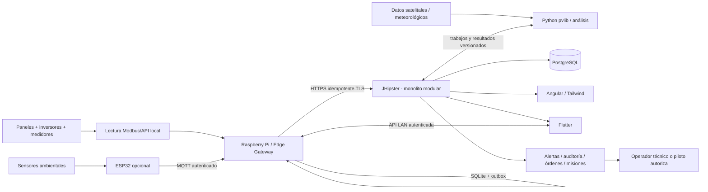

# HelioGuard — Arquitectura maestra y contrato SDD v4

## 1. Visión y propuesta verificable

HelioGuard integra **observabilidad energética + confianza de datos + respuesta operativa** para hogares, instalaciones remotas, empresas mantenedoras y parques solares. Detecta déficit frente a un modelo limpio/operativo, registra la procedencia y calidad de datos, abre incidentes de confiabilidad y coordina intervención humana o con drones autorizados.

**MVP hackatón:** experiencia Angular real con mocks y flujo completo, sin promesas de conexión física. **MVP piloto:** gateway edge real + JHipster/PostgreSQL + cálculo físico + comprobación de integridad y orden de trabajo. **Producto posterior:** auditoría formal, planes, integración de operadores de drones y aseguradoras autorizadas.

## 2. Responsabilidades y flujo

**Flujo de energía diferente de flujo de datos:** Paneles → protecciones CC → inversor → protecciones CA → cargas / medidor / red; baterías y BMS solo en sistema híbrido/aislado compatible. Raspberry y ESP32 monitorean, **no transportan energía ni reemplazan protecciones eléctricas**.

## 3. Stack y despliegue

| Capa | Decisión | Observaciones |
|---|---|---|
| Backend | JHipster monolito Java 21 + Spring Boot + Liquibase + PostgreSQL | Fijar versión del generador tras comprobar compatibilidad; JDL draft |
| Backend dominios | `identity`, `assets`, `telemetry`, `energy`, `integrity`, `audits`, `operations`, `plans` | No crear 8 microservicios prematuramente |
| Web | Angular standalone + Tailwind CSS + Angular Signals | Mock-first mediante ports/adapters |
| Mobile | Flutter con FVM, Riverpod/GoRouter, Drift/SQLite | Modo campo, offline y sincronización |
| Edge | Raspberry Pi OS Lite + servicio ligero + SQLite/outbox + MQTT broker | ARM64 y almacenamiento persistente; respaldo de energía |
| Sensores | ESP32 + ESP-IDF opcional | Si el inversor ya da datos usar conexión directa |
| Energía | Worker Python con pvlib; RdTools cuando exista histórico adecuado | Versionar entradas, límites y evaluación de incertidumbre |
| Mensajería | Mosquitto / MQTT en edge; ingestión HTTPS cloud | TLS, credenciales únicas y ACL |
| Infra | Docker Compose DEV, EDGE, CLOUD (plantillas) | Web y servicios en Docker; app Flutter/firmware con CLI |

En JHipster, `User` es entidad integrada. Los roles tenant son `OrganizationMembership`, nunca confundir `ROLE_ADMIN` global con dueño de una empresa.

## 4. Multi-tenant: decisión y límites

- Esquema pooled PostgreSQL con `organization_id` y filtros/autorización a nivel servicio; RLS como defensa adicional.
- `InstallationAccessGrant` autoriza prestador externo sobre **una instalación concreta**, sin transferir propiedad.
- Técnico externo solo puede ver ámbitos delegados y vigentes; listas, archivos y eventos obedecen a las mismas verificaciones.
- Crear claves foráneas compuestas `(id, organization_id)` para impedir referencias cruzadas incorrectas. Configurar RLS `FORCE`, rol runtime sin `BYPASSRLS` y contexto transaction-local; test de reutilización de pool.
- `EvidenceSource`, `EquipmentModel`, `MetricDefinition` son catálogos globales controlados. `DroneAsset` pertenece a empresa prestadora; `DroneMission` al tenant propietario de la instalación y opcionalmente referencia al proveedor.
- Angular demo usa **permisos simulados**, no es una barrera de seguridad verdadera.

## 5. Cálculo energético defendible

- Potencia instantánea: **W/kW**. Energía integrada o contador: **Wh/kWh**. Nunca tratar una lectura de potencia como energía.
- `expectedWh`: modelo por intervalo y condiciones reales, sistema limpio pero con edad actual y restricciones operativas conocidas.
- `deficitWh = max(0, expectedWh - actualWh)` sobre intervalos comparables con cobertura y calidad suficiente; estimación con incertidumbre.
- Etiquetar causa `SOILING`, `HARDWARE`, `SHADING`, `THERMAL`, `WEATHER`, `CURTAILMENT`, `BATTERY_RESTRICTION`, `UNKNOWN` solo si evidencia lo permite. Causas propuestas no deben sumar más del déficit (evitar doble conteo).
- `valueARS = lost_self_consumption_kWh * avoided_purchase_rate + lost_export_kWh * export_rate`, con tarifas por vigencia, consumo, capacidad de exportación y limitaciones declaradas.
- El retorno de limpiar depende de recuperación estimada **hasta la próxima intervención/lluvia efectiva**, menos limpieza, traslados y riesgos; seguridad prima sobre rentabilidad.
- Las pérdidas por frío, nubes o baja irradiancia no son automáticamente pérdidas evitables. Eventos normales se registran sin generar alertas de suciedad.

## 6. Integridad y seguridad de telemetría

- Cada dispositivo tiene identidad, `eventId`, `bootId`, `sequenceNumber`, timestamp, calidad y validación de autenticación/canal.
- Replay determinista: detectar identificador o secuencia duplicada en ventana y contexto de reinicio; retener evento y alertar proporcionalmente. Fuentes sin estos campos se registran como verificación limitada.
- Inyección falsa: comprobar autenticación y coherencia con límites del inversor, energía/irradiancia y series históricas, incluyendo bandas de incertidumbre. **Inconsistencia ≠ ataque demostrado**.
- Registrar evidencia y cadena de procedencia (`TelemetryIntegrityEvent`, `IntegrityAssessment`, `DataProvenance`, `SecurityIncident`). No almacenar claves privadas en JPA.
- Toda acción sobre inverter/Modbus y dron está en **solo lectura o simulación** hasta control de seguridad y autorización profesional.

## 7. Satélite, mapa térmico y dron

- Satélite: recurso solar y nubes / información meteorológica externa. Sentinel-2 ofrece píxeles 10–60 m, no termografía de módulos. GOES tiene píxeles ~0,5–2 km, no geolocaliza panel defectuoso.
- El mapa del parque es **vista cenital GIS / ilustración georreferenciada**, no «imagen térmica del satélite». Localización por telemetría por inversor/string, y termografía mediante dron apto.
- `DroneMission`: crear propuesta → seguridad → autorización → despacho/ejecución supervisada → resultado. En la demo, solo estados animados, nunca control real.
- Limpieza depende de clima, fabricante, compatibilidad del método, tratamiento de agua, acceso y operador. Hielo, viento fuerte, daño eléctrico u operación insegura bloquean limpieza.

## 8. Actores y productos

- Plataforma: admin global autorizado, soporte auditado.
- Tenant: dueño, operador, técnico, auditor, visor.
- Acceso delegado: empresa de mantenimiento a instalación de otra empresa.
- Cliente: hogar, cooperativa, municipio, operador/empresa instaladora, parque solar.
- Servicios: preauditoría digital, auditoría profesional, monitoreo, informes, alertas, plan de mantenimiento, gestión de órdenes. Seguro indemnizatorio solo por entidad aseguradora autorizada.

## 9. Principios de ingeniería

- DDD modular + 3FN como objetivo en transacciones; replicación `organization_id` para RLS solo con integridad referencial verificada.
- JDL **no** define el sistema entero: Liquibase para métricas de series temporales, índices, FKs compuestas, RLS, outbox, retención y logs.
- Contratos versionados JSON Schema/OpenAPI; migración compatible expand/contract.
- Cada evento de gateway es idempotente `gatewayId + eventId`. Control de orden por `bootId + sequenceNumber` es independiente.
- Cloud fuera de línea → edge continúa; sincronización sin duplicación al volver; móvil usa LAN si está disponible con auth local.
- Observabilidad: logs estructurados sin secretos, métricas, trazas de ingestión, freshness y colas pendientes; alerts de infraestructura.
- Seguridad: PKCE en móvil/web cuando haya OIDC, privilegio mínimo, credenciales por gateway, TLS, segmentación OT y backups con restauración probada.

## 10. Definition of Done SDD

`SPEC` (historia + límites) → `DESIGN` (modelo/ADR/contrato) → `TASKS` (backend, edge, web, móvil, QA) → `IMPLEMENT` (CLI y pruebas) → `VERIFY` (seguridad, cálculo, UX, datos) → `DEMO` (evidencias).

No cerrar sprint por tener pantallas o gráfico. Exigir datos de prueba, rutas funcionales, tests y resultado documentado de comandos reales.

## 11. Arquitectura por etapas

- **Hackatón:** Angular standalone + Tailwind + fixtures mock/escenarios, simular dron y replay; sin JHipster conectado.
- **S0.5–S3:** modelo/JDL, tenant, gateways, telemetría real de solo lectura, sincronización.
- **S4–S6:** energía, pérdida y dinero, integridad y respuesta a anomalías.
- **S7–S8:** auditoría, planes, orden, autorización de misión y verificación.
- **S9–S10:** hardening, QA, piloto medido y estimación comercial.

Plan detallado en `02_SPRINTS_INTEGRALES_S0_S10.md`. Frontend independiente en `03_SPRINTS_FRONTEND_DEMO_F0_F7.md`.
