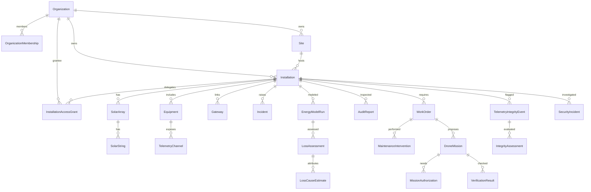

# Modelo ER, normalización e aislamiento multiempresa — HelioGuard v4

**Estado:** borrador de diseño, NO JDL importado ni migraciones ejecutadas. Fuente: `specs/domain.v4.draft.jdl` (47 entidades, 114 relaciones ManyToOne declaradas). No usar JDL anteriores ni listados conceptuales como contrato.

## 1. Bounded contexts y agregados

| Contexto | Entidades | Regla / agregado |
|---|---|---|
| Tenant | Organization, OrganizationMembership, Site, Installation, InstallationAccessGrant | Instalación pertenece a organización propietaria; acceso tercero delegado |
| Inventario/IoT | EquipmentModel, SolarArray, SolarString, Equipment, Gateway, MetricDefinition, TelemetryChannel | Un string pertenece a un arreglo; equipos a instalación; catálogos globales |
| Operación | AlertRule, Incident, IncidentEvent | Regla genera incidente deduplicado con eventos históricos |
| Energía | EnergyModelRun, LossAssessment, LossCauseEstimate | Cada evaluación tiene método/versiones/intervalo, causas no se duplican |
| Economía | TariffPlan, TariffRate, EconomicAssessment | Tarifas con vigencia, instantánea de valoración, moneda explícita |
| Auditorías | AuditTemplate, AuditQuestion, AuditReport, AuditAnswer, AuditFinding, AuditEvidence | Plantillas versionadas; respuestas separadas de hallazgos |
| Mantenimiento | MaintenancePlan, MaintenancePlanVersion, ServiceAgreement, PlanSubscription, ServiceProposal, WorkOrder, WorkOrderTask, MaintenanceIntervention, InterventionEvidence, RecoveryAssessment | Contratos/planes versionados; recuperación y evidencia ligadas a trabajo |
| Integridad | DeviceIdentity, TelemetryIntegrityEvent, IntegrityAssessment, EvidenceSource, DataProvenance, SecurityIncident | Fuente y anomalía separadas de dictamen; identidad sin secreto |
| Drones | DroneAsset, DroneMission, MissionAuthorization, VerificationResult | Recurso del prestador; misión corresponde a instalación; despegue solo autorizado |

## 2. Cardinalidades principales

**N:M:** `User` ↔ `Organization` por `OrganizationMembership` con rol y estado; delegación entre tenant dueño y proveedor por `InstallationAccessGrant`; no se traslada propiedad del recurso. Restricción adicional: `DroneAsset.organization` puede ser empresa prestadora y la misión conserva `DroneMission.organization` del dueño; validar con grant y contrato de servicio.

## 3. Normalización

- **Objetivo 3FN** de datos operacionales, revisable por dependencias funcionales y claves candidatas. Inventario de `EquipmentModel` separado del equipo físico; tasa tarifaria separada del `TariffPlan`; `MaintenancePlanVersion` mantiene contrato aceptado.
- `AuditTemplate` + `AuditQuestion` versionados: una auditoría usa versión inmutable. Evitar editar preguntas históricas en sitio.
- `TelemetryIntegrityEvent` es un suceso; `IntegrityAssessment` es evaluación; `SecurityIncident` coordina investigación. No duplicar el mismo tipo en tres tablas.
- `EvidenceSource` global describe proveedor y licencia; `DataProvenance` asocia fuente/registro/intervalo y calidad. Procedencia no reemplaza criptografía.
- `DroneMission` incluye estado/propuesta y autorización separada para guardar quién, cuándo, condiciones y por qué. Nunca inferir autorización a partir de estado UI.
- `organization_id` se repite intencionalmente en dependientes para RLS/particionado, aunque exista FK hacia instalación. Se acepta **solo** con restricciones compuestas y tests que garanticen coherencia.
- Medidas de alta frecuencia fuera del ORM: `telemetry_measurement`, `weather_observation`, rollups diarios, colas/outbox y registros de rechazo; sólo objetos de negocio están en JDL.

## 4. Restricciones SQL fuera del JDL

1. `UNIQUE(organization_id, code)` en instalación; `(organization_id, reference_code)` en OT y seguridad; `(organization_id, device_uid)` según diseño y global `deviceUid` solo si es realmente global.
2. `FK(child.installation_id, child.organization_id) REFERENCES installation(id, organization_id)` y similares para incidentes, auditorías y misiones.
3. Prohibir grant a tenant inexistente o suspendido, ventanas `validUntil > validFrom`, revocación, y no permitir autoexposición accidental.
4. `UNIQUE(gateway_id, event_id)` en ingesta; para la protección de replay `UNIQUE(device_identity_id, boot_id, sequence_number)` cuando fabricante y protocolo lo admitan. Reinicios legítimos requieren nuevo `bootId` autenticado.
5. Verificar rangos de temperaturas, porcentajes, precios no negativos, intervalos temporales, `currencyCode` ISO y enumeraciones.
6. RLS con `FORCE ROW LEVEL SECURITY`, rol runtime sin `BYPASSRLS`, `SET LOCAL` dentro de transacción y test de pooling. Acceso delegado requiere política explícita o servicio confiable, NO confiar solo en `organization_id` de request.
7. FK global/local: catálogos controlados por admin plataforma; algunos no están sujetos a RLS tenant y requieren ACL de escritura.
8. No almacenar firmas o tokens secretos sin política; guardar hash de integridad/sellos, no llaves privadas.

## 5. Definición de datos y políticas de retención

- `Instant` UTC; zona horaria IANA en `Site.timeZone` para presentación; sensor tiene su propio reloj y flags.
- Electricidad W, Wh; meteorología °C, W/m²; dinero `BigDecimal` y `ISO 4217`; no convertir potencia a energía sin integración temporal.
- Frecuencia de telemetría definida por dispositivo y capacidad real; out-of-order y late events soportados sin alterar datos previos.
- Datos crudos con retención definida por contrato y necesidad; rollups para histórico extenso, anonimización/exportación conforme políticas de privacidad.
- Evidencia de auditoría y seguridad con almacenamiento externo por clave, hash SHA-256, permisos y URLs firmadas de corta duración.

## 6. Matriz de aislamiento crítico

| Prueba | Resultado esperado |
|---|---|
| Usuario empresa A consulta instalación empresa B | 403 o 404 según política; nunca filtra datos |
| Mismo usuario tiene 2 membresías, cambia empresa | Lista y cache por empresa activa, sin datos mezclados |
| Técnico empresa A con grant a instalación B | Solo ve la B autorizada, nunca vecinas |
| Gateway A publica evento para instalación B | Rechazo + evento de seguridad |
| Intento de leer evidencia con ID adivinado | Denegado y sin URL compartida |
| `DroneAsset` de prestador A vinculado a misión B | Solo si grant/contrato vigente y permisos correctos |
| Ataque replay en tenant A | No afecta dedup ni secuencias del tenant B |
| conexión SQL de tenant A reutilizada por B | Ningún residuo RLS de sesión previa |
| reporte de plataforma agregada | Autorización expresa y agregación sin filtrar identificadores |

## 7. Puerta de calidad Sprint 0.5

- [ ] Inventario del esquema, inversores y dashboard existentes.
- [ ] Parser real `jhipster jdl specs/domain.v4.draft.jdl --json-only` en sandbox y registro de errores; JDL no está validado por esta entrega.
- [ ] Generación JPA/Liquibase, revisión de relaciones/sesgos de generación; rollback probado.
- [ ] 3FN revisada con claves, NULL, FKs, enums y estabilidad de versionado.
- [ ] RLS y grants con fixtures de al menos 2 organizaciones y una tercera prestadora.
- [ ] Test de 100% entidades y 114 relaciones reconciliadas con modelo y UI.
- [ ] Pruebas negativas + no transferencia de propiedad en misión dron.

Ver SQL de referencia en `database/tenant-integrity.example.sql`. NO ejecutar sin adaptarlo al esquema Liquibase real.
