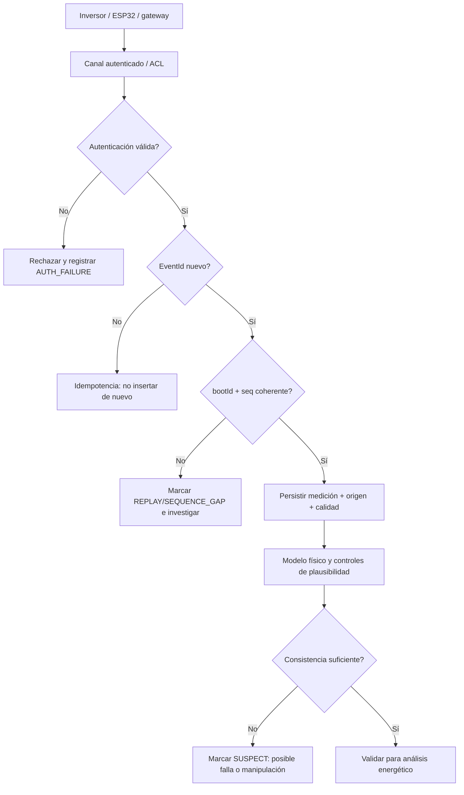

# HelioGuard — Seguridad e integridad de telemetría (SDD v4)

## 1. Alcance y amenaza

Proteger la confianza en la información de producción solar sin confundir **detección de anomalías** con **atribución de un ciberataque**. Amenazas: replay, reordenamiento, datos inyectados por un dispositivo comprometido, credenciales filtradas, sensores descalibrados, reloj incorrecto, ausencia WAN, gateway comprometido y alteración de registros de auditoría.

Activos: inversores/sensores, identidad de dispositivo, gateway, API cloud, histórico, cálculos de energía, información de propietarios/tenants, órdenes y autorizaciones de misiones.

## 2. Flujo de validación

**Replay determinista:** reutilización de `eventId` o de secuencia procesada para un dispositivo y un arranque específico. No usar solo timestamp: relojes pueden desviarse y la red puede reordenar. Un `bootId` debe ser resistente a colisiones y su relación con identidad validada. Reintentos de transporte son normales y no equivalen automáticamente a ataque.

**Inyección/valor físicamente improbable:** comprobar límites eléctricos del inversor, física del módulo, irradiancia con bandas de error, temporalidad y otras fuentes. Etiquetar `PHYSICAL_INCONSISTENCY`/`UNDER_REVIEW`. No atribuir actor ni dolo sin evidencia forense.

**Criptografía:** TLS y autenticación de gateway/dispositivo; si se firma payload definir canonicalización, algoritmo, gestión/rotación de claves y revocación. El frontend simula la decisión, pero NO certifica autenticidad real.

## 3. Estados y entidades

- `DeviceIdentity`: `deviceUid`, fingerprint/identidad, protocolo, estado y rotación de referencia (nunca guardar clave privada).
- `TelemetryIntegrityEvent`: evento, tipo, tiempos y hashes; no falsificar contenido de lectura original.
- `IntegrityAssessment`: reglas/modelo/versión, conclusión de confianza y motivos.
- `SecurityIncident`: caso de investigación, prioridades, responsables y cierre trazable.
- `EvidenceSource`: catálogo del proveedor y licencia de irradiancia/meteo/cámaras.
- `DataProvenance`: medición, huella de contenido, fechas, fuente, calidad, versión de algoritmo.
- `Incident/IncidentEvent`: incidentes operativos de producción; enlace a seguridad cuando corresponda sin mezclarlos.

## 4. Ejemplos de prueba para demostración

| Caso | Entrada simulada | Resultado correcto |
|---|---|---|
| Replay exacto | Igual `eventId`, `bootId`, `sequenceNumber` | deduplicar y registrar actividad según regla |
| Replay secuencia | `eventId` nuevo pero mismo `bootId+sequenceNumber` | evento REPLAY/UNDER_REVIEW, no usar lectura como nueva |
| Reinicio legítimo | nuevo bootId autenticado, seq=0 | aceptar sin falso positivo por reinicio |
| Red fuera de orden | seq 100,102,101 válidas y únicas en ventana | aceptar según política de watermark, no afirmar ataque |
| Inyección alterada en canal autenticado | firma inválida/cert fallido | rechazar por SIGNATURE_INVALID/AUTH_FAILURE |
| Potencia improbable | reporta 8 MW, límite físico modelado 5,2 MW (con incertidumbre) | aislar como SUSPECT, NO afirmar hackeo |
| Sensor calibrado incorrecto | lecturas erróneas pero firma válida | SUSPECT sin evidencia de ataque |
| Intermitencia WAN | outbox reintenta eventos persistidos | una sola medición efectiva en cloud |
| Tenant cruzado | gateway A publica instalación B | rechazar aunque el evento sea único |

## 5. Datos y privacidad

- No guardar secretos en fixtures, git, demo o logs.
- Registrar identidades de operador y acciones de seguridad con control de acceso tenant y retención definida.
- Eventos rechazados pueden incluir metadatos y hash, pero no volcar payloads confidenciales indefinidamente.
- Autorizar explícitamente accesos forenses de operador de plataforma; auditar también accesos privilegiados.
- Cuidar sincronización NTP y fallas de reloj; en gateway sin WAN, validar tiempo monotónico local con marca de recepción.

## 6. API/contratos de demo

- `contracts/telemetry-event.schema.json` + ejemplo: medición e identificadores opcionales de secuencia.
- `contracts/telemetry-integrity-event.schema.json` + ejemplo: clasificación/evento de integridad.
- El JDL no modela cada mensaje MQTT crudo; para series y rechazos usar tablas específicas con partición e índices.

## 7. DoD y límites

- Reglas unitarias deterministas comprobables; pruebas multiempresa y reintentos reales.
- Panel UI muestra: qué dato, qué fuente, por qué sospechoso, qué evidencia respalda la decisión y próximo paso.
- El satélite es **fuente independiente para contraste meteorológico**, no certificador de verdad ni detector concluyente de ataques.
- La aplicación no aísla físicamente OT ni opera inversores sin autorización; `quarantine` significa excluir una medición del pipeline operativo, conservando trazabilidad.
